# StayVoyage

**Book Stays. Build Trips. Travel Your Way.**

StayVoyage is a subscription-based hotel booking and custom travel-planning platform. Customers can buy a monthly membership that grants hotel-night credits, book eligible hotels with those credits or as regular paid stays, and design multi-day trips in a drag-and-drop Tour Builder that prices every change on the server.

The project is split into a Laravel 12 REST API (`backend/`) and a React + TypeScript single-page app (`frontend/`). The production build of the SPA is served by Laravel, so the whole platform runs from one origin.

---

## Table of Contents

- [Key Features](#key-features)
- [Technologies Used](#technologies-used)
- [Project Screenshots](#project-screenshots)
- [Project Structure](#project-structure)
- [Requirements](#requirements)
- [Installation and Setup](#installation-and-setup)
- [Environment Configuration](#environment-configuration)
- [Database Setup](#database-setup)
- [Running the Project](#running-the-project)
- [Important Modules](#important-modules)
- [API Overview](#api-overview)
- [Testing](#testing)
- [Security Notes](#security-notes)
- [Future Improvements](#future-improvements)

---

## Key Features

**Membership**
- Configurable plans (price, duration, included nights, per-booking limits, eligible hotels and room types, blackout dates, cancellation, no-show and expiry rules, auto-renewal)
- Night-credit wallet backed by an append-only transaction ledger (purchase, deduction, cancellation refund, expiration, admin adjustment)
- Rules are frozen on each membership at purchase time, so later plan edits never change an existing customer's terms

**Hotels and booking**
- Search with destination, dates, guests and rooms; filters for price, rating, stars, amenities, distance, property type, breakfast, free cancellation and membership eligibility; sorting and pagination
- Hotel detail pages with gallery, rooms, live per-night pricing, policies, OpenStreetMap location and verified reviews
- Membership bookings (room covered by night credits, guest pays taxes and a booking fee) and regular paid bookings
- Per-night inventory with base, weekend, seasonal and date-specific prices; admin blocking and stop-sell
- Payment holds, cancellations with policy preview, automatic refunds and returned nights, PDF invoices

**Tour Builder**
- Day-by-day itineraries with hotels, flights, trains, buses, taxis, private and rental cars, airport and hotel transfers, activities, attractions, guides, meals and free-form notes
- Drag-and-drop reordering on desktop; explicit move controls on mobile
- Live server-side pricing with availability checks (hotel inventory, activity slot capacity, guide working days)
- Save, duplicate, share through a public link or WhatsApp, and book the whole trip in one checkout
- Admin-managed tour packages that customers can copy and customise

**Platform**
- Customer dashboard, notification centre, wishlist, payment history and profile security (TOTP two-factor authentication)
- Admin panel: dashboard charts, hotels, rooms, availability calendar, destinations, tour catalogue and packages, membership plans and wallets, bookings, payments and refunds, users, coupons, review moderation, FAQs, contact messages, roles and permissions, settings, audit logs
- Reports (revenue, bookings, memberships, hotels, tours, customers, refunds) with date ranges and CSV, Excel and PDF export
- Hotel partner portal scoped to the partner's own properties
- Server-rendered SEO tags, JSON-LD structured data, `sitemap.xml` and `robots.txt`

---

## Technologies Used

| Area | Technology |
|---|---|
| Backend | PHP 8.2+ (developed on 8.3), Laravel 12, Laravel Sanctum 4 (SPA cookie authentication) |
| Background work | Laravel Queues (Redis), Scheduler, Events, Notifications |
| Database | MySQL 8.0.16+ (CHECK constraints are required) |
| Cache / sessions / queue | Redis (phpredis) |
| Frontend | React 19, TypeScript 5.8, Vite 6, React Router 7 |
| Data and forms | TanStack Query 5, Axios, React Hook Form 7, Zod 3 |
| UI | Tailwind CSS 3, Lucide icons, Sonner toasts, Recharts 3, dnd-kit, Leaflet + React Leaflet (OpenStreetMap tiles) |
| Payments | Built-in signed sandbox gateway, Razorpay PHP SDK, Stripe PHP SDK (test mode) |
| Documents | barryvdh/laravel-dompdf (invoices, PDF reports), OpenSpout (Excel export) |
| Security | pragmarx/google2fa and bacon/bacon-qr-code (TOTP two-factor authentication) |

---

## Project Screenshots

Screenshots are taken from the running application with the seeded demo data. Files are stored in [`docs/screenshots/`](docs/screenshots).

### Customer website

**Home page**

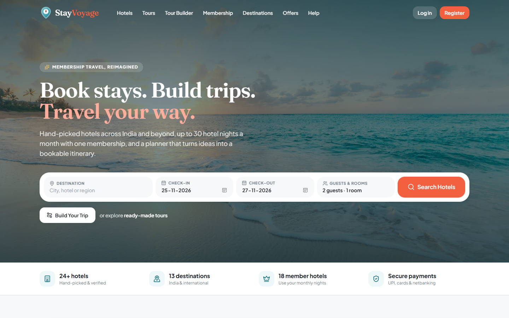

Hero section with hotel search (destination, dates, guests and rooms) and a shortcut to the Tour Builder.

**Hotel search**

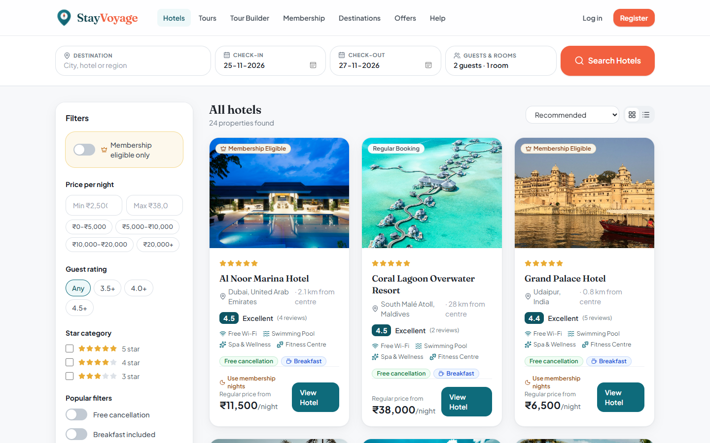

Filter sidebar (membership eligibility, price, rating, stars, amenities, distance, property type) with result cards that separate membership-eligible and regular-only hotels.

**Hotel details**

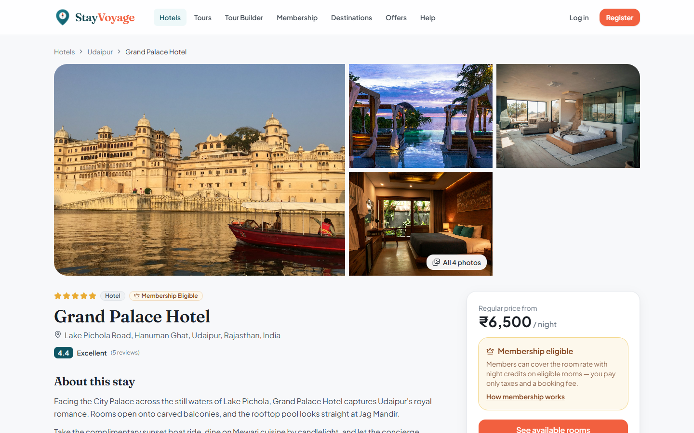

Photo gallery, star category, guest rating, amenities and the regular "from" price alongside membership eligibility.

**Membership plans**

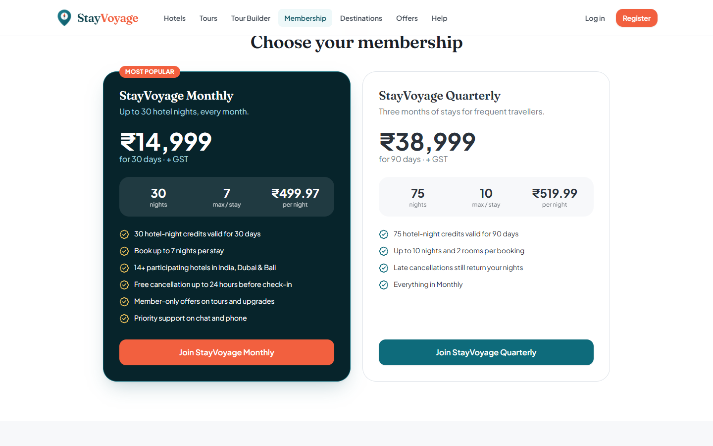

Configurable plans showing included nights, the maximum stay per booking, the effective price per night and plan benefits.

**Tour package**

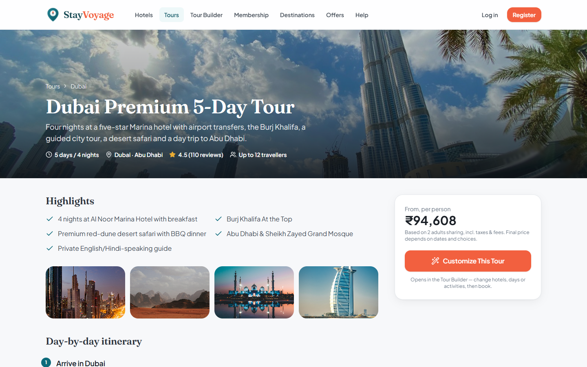

Ready-made tour with highlights and gallery. "Customize This Tour" copies the full itinerary into the Tour Builder.

### Booking and customer account

**Hotel checkout**

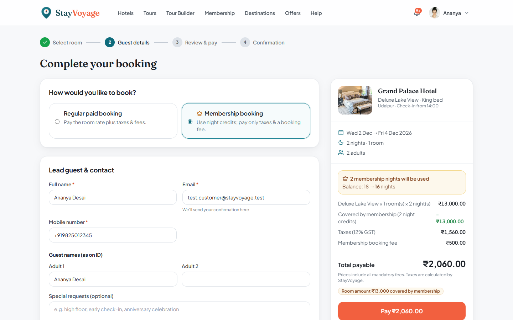

Choice between a membership and a regular booking, guest details, and a price summary calculated by the server, including the nights that will be deducted.

**Customer dashboard**

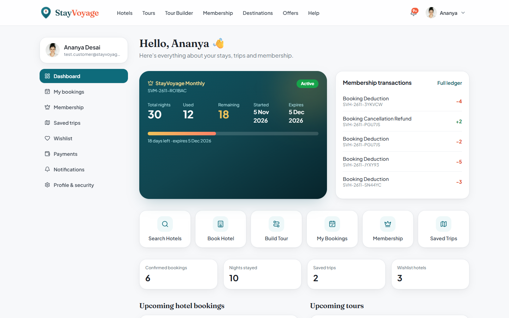

Membership card with total, used and remaining nights and the expiry date, recent ledger transactions and quick actions.

**Membership wallet**

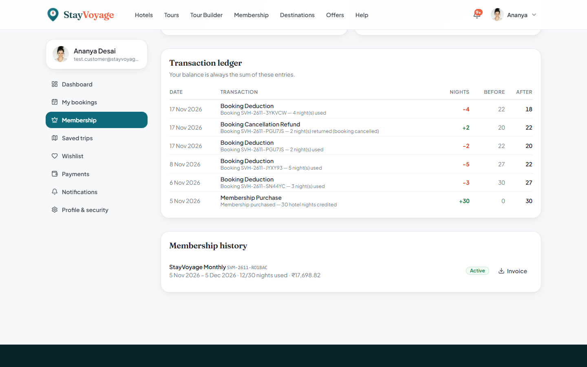

Night-credit ledger showing every purchase, deduction and cancellation refund with balances before and after.

**Tour Builder**

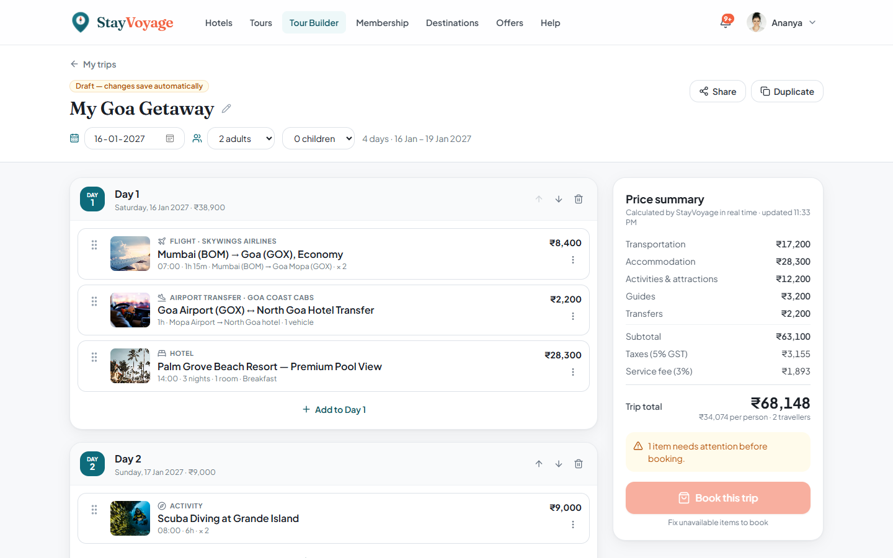

Day-by-day itinerary with flights, transfers, hotels, activities and guides, plus a live price summary. Unavailable items are flagged before booking.

### Administration and partner portal

**Admin dashboard**

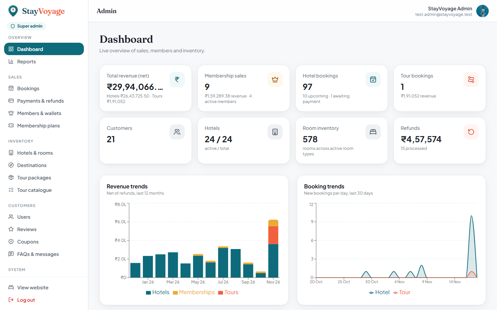

Revenue, bookings, members, inventory and refunds, with revenue, booking and membership trend charts.

**Availability and pricing calendar**

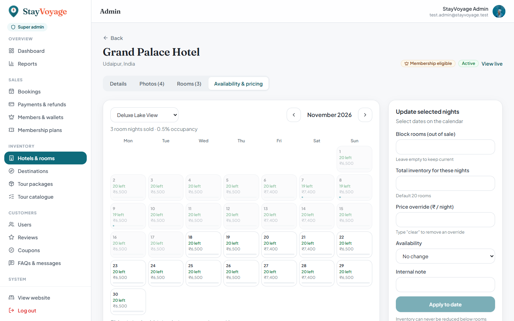

Per-night inventory for a room type: rooms left, price per night and occupancy, with range updates for blocking rooms, closing dates and price overrides.

**Reports**

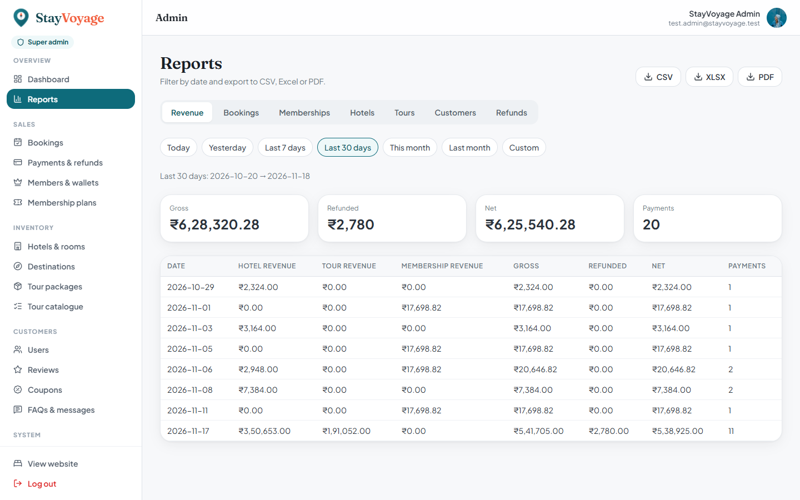

Revenue, booking, membership, hotel, tour, customer and refund reports with date presets and CSV, Excel and PDF export.

**Hotel partner portal**

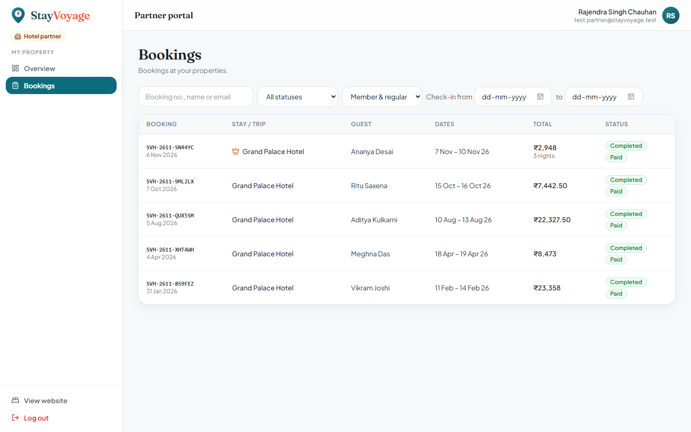

Partners see only the bookings and hotels linked to their own account.

### Mobile

<table>
  <tr>
    <td align="center" width="50%">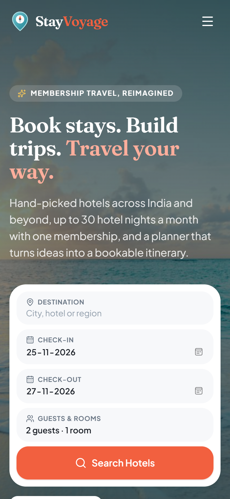<br><sub>Home page with stacked search form</sub></td>
    <td align="center" width="50%">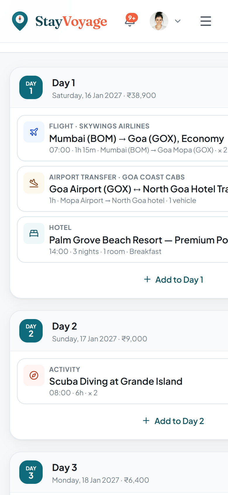<br><sub>Tour Builder with touch-friendly move controls</sub></td>
  </tr>
</table>

---

## Project Structure

```
StayVoyage/
├── backend/                         Laravel 12 API (also serves the built SPA)
│   ├── app/
│   │   ├── Enums/                   Booking, payment, membership, ledger and trip item types
│   │   ├── Events/  Listeners/      Domain events and their side effects
│   │   ├── Exceptions/              DomainException (business-rule errors)
│   │   ├── Http/
│   │   │   ├── Controllers/
│   │   │   │   ├── Api/V1/          Public and customer endpoints
│   │   │   │   ├── Api/V1/Admin/    Admin endpoints (partner routes reuse several of them)
│   │   │   │   ├── SpaController.php    Serves the SPA with page-specific SEO tags
│   │   │   │   └── SeoController.php    sitemap.xml and robots.txt
│   │   │   ├── Middleware/          Permission, role, account status, admin 2FA, security headers
│   │   │   ├── Requests/            Form Request validation
│   │   │   └── Resources/           API Resources
│   │   ├── Jobs/                    Invoice generation
│   │   ├── Models/
│   │   ├── Notifications/           Mail + in-app notifications
│   │   ├── Policies/                Booking, Hotel (partner scoping), UserTrip, Review
│   │   ├── Services/
│   │   │   ├── Auth/                TwoFactorService
│   │   │   ├── Booking/             HotelBookingService, TourBookingService, BookingLifecycleService
│   │   │   ├── Hotel/               InventoryService, HotelPricingService, HotelSearchService
│   │   │   ├── Membership/          MembershipWalletService, MembershipRulesService, MembershipService
│   │   │   ├── Payments/            PaymentService and Sandbox / Razorpay / Stripe gateways
│   │   │   ├── Tour/                TourPricingService, TripBuilderService, TourPackageService
│   │   │   └── ...                  Coupon, Invoice, Report, Review, Settings, AuditLogger, ImageUpload
│   │   └── Support/                 ApiResponse, Money, Media helpers
│   ├── config/                      Includes payments.php
│   ├── database/
│   │   ├── migrations/
│   │   └── seeders/                 Roles, content, hotels, tour catalogue, plans and coupons, demo data
│   ├── resources/
│   │   ├── seed-images/             Photos copied to public storage by the seeder
│   │   └── views/pdf/               Invoice and report PDF templates
│   ├── routes/                      api.php, web.php, console.php (scheduled commands)
│   └── tests/Feature/               Membership, booking, Tour Builder and authorization tests
├── frontend/                        React + TypeScript SPA
│   ├── public/
│   ├── src/
│   │   ├── components/              UI kit, layouts, logo, cards, admin kit, map
│   │   ├── hooks/  providers/       Config, page meta, authentication
│   │   ├── lib/                     API client, formatting, payment launcher
│   │   ├── pages/                   Public, auth, checkout, account, builder, admin, partner
│   │   ├── types/
│   │   └── router.tsx
│   ├── tailwind.config.js           Brand colour tokens
│   └── vite.config.ts               Dev proxy and build output to backend/public/app
├── docs/
│   └── DEPLOYMENT.md                Production deployment and backup guide
└── start-workers.bat                Starts the queue worker and scheduler on Windows
```

---

## Requirements

- PHP 8.2 or newer with extensions: `pdo_mysql`, `mbstring`, `openssl`, `curl`, `gd`, `intl`, `zip`, `bcmath`, `fileinfo`, `redis` (phpredis)
- Composer 2
- MySQL 8.0.16 or newer
- Redis
- Node.js 20+ and npm (developed with Node 22)
- A web server (Apache or Nginx) or `php artisan serve` for local use

---

## Installation and Setup

```bash
git clone <repository-url> StayVoyage
cd StayVoyage
```

**Backend**

```bash
cd backend
composer install
cp .env.example .env
php artisan key:generate
php artisan storage:link
```

Edit `.env` (see [Environment Configuration](#environment-configuration)), create the database, then migrate and seed (see [Database Setup](#database-setup)).

**Frontend**

```bash
cd ../frontend
npm install
npm run build        # outputs the SPA to backend/public/app
```

---

## Environment Configuration

All configuration lives in `backend/.env`. Use `backend/.env.example` as the template and never commit real values.

| Variable | Purpose |
|---|---|
| `APP_URL` | Base URL used for canonical links and generated absolute URLs |
| `FRONTEND_URL` | Public SPA URL used in emails and payment return links |
| `APP_TIMEZONE` | Application timezone |
| `DB_HOST`, `DB_PORT`, `DB_DATABASE`, `DB_USERNAME`, `DB_PASSWORD` | MySQL connection |
| `REDIS_HOST`, `REDIS_PORT`, `REDIS_PASSWORD`, `REDIS_DB`, `REDIS_CACHE_DB`, `REDIS_PREFIX` | Redis connection |
| `SESSION_DRIVER`, `CACHE_STORE`, `QUEUE_CONNECTION` | Set to `redis` |
| `SANCTUM_STATEFUL_DOMAINS` | Hosts (with ports) allowed to use cookie authentication |
| `MAIL_MAILER`, `MAIL_HOST`, `MAIL_PORT`, `MAIL_USERNAME`, `MAIL_PASSWORD`, `MAIL_FROM_ADDRESS` | Outgoing email (`log` driver works without any setup) |
| `PAYMENT_DEFAULT_GATEWAY` | `sandbox`, `razorpay` or `stripe` |
| `PAYMENT_SANDBOX_ENABLED` | Enables the built-in test gateway (on by default outside production) |
| `RAZORPAY_KEY_ID`, `RAZORPAY_KEY_SECRET`, `RAZORPAY_WEBHOOK_SECRET` | Razorpay test-mode credentials |
| `STRIPE_KEY`, `STRIPE_SECRET`, `STRIPE_WEBHOOK_SECRET` | Stripe test-mode credentials |
| `GOOGLE_MAPS_API_KEY` | Optional; maps use OpenStreetMap when empty |
| `SEED_TEST_PASSWORD` | Password assigned to seeded demo accounts (local use only) |

Example database section with placeholders:

```env
DB_CONNECTION=mysql
DB_HOST=127.0.0.1
DB_PORT=3306
DB_DATABASE=your_database_name
DB_USERNAME=your_username
DB_PASSWORD=your_password
```

When running the SPA on a different host or port (for example `php artisan serve` on port 8000 or the Vite dev server on 5173), make sure that host and port is listed in `SANCTUM_STATEFUL_DOMAINS`.

---

## Database Setup

Create an empty UTF-8 database:

```sql
CREATE DATABASE your_database_name CHARACTER SET utf8mb4 COLLATE utf8mb4_unicode_ci;
```

Run the migrations and seed demo data:

```bash
cd backend
php artisan migrate --seed
```

To rebuild from scratch at any point:

```bash
php artisan migrate:fresh --seed
```

The seeders create roles and permissions, 13 destinations, 24 hotels with rooms and photos, the tour catalogue and 8 tour packages, two membership plans, coupons, and demo customers with bookings, payments, reviews and trips. Photos from `resources/seed-images/` are copied to `storage/app/public/seed/`.

Seeded demo accounts (password taken from `SEED_TEST_PASSWORD`):

| Role | Email |
|---|---|
| Customer (active membership with bookings, trips and payments) | `test.customer@stayvoyage.test` |
| Super admin | `test.admin@stayvoyage.test` |
| Staff | `staff@stayvoyage.test` |
| Hotel partner (one hotel) | `test.partner@stayvoyage.test` |

Demo seeders are intended for local development only. In production, seed only `RolesAndPermissionsSeeder`.

---

## Running the Project

**Option 1: Laravel development server**

```bash
cd backend
php artisan serve --port=8096
```

Open `http://localhost:8096`.

**Option 2: Apache or Nginx**

Point the document root at `backend/public` with URL rewriting enabled (`AllowOverride All` for Apache). See `docs/DEPLOYMENT.md` for an Nginx example.

**Frontend with hot reload (development)**

```bash
cd frontend
npm run dev
```

The Vite server runs on `http://localhost:5173` and proxies `/api`, `/sanctum` and `/storage` to the backend. Set `VITE_BACKEND_URL` if the backend is not on `http://127.0.0.1:8096`.

**Queue worker and scheduler**

Emails, notifications and invoice PDFs are queued, and unpaid booking holds are released by the scheduler, so both should run during development:

```bash
cd backend
php artisan queue:work redis
php artisan schedule:work
```

On Windows, `start-workers.bat` opens both in separate windows.

Scheduled commands (defined in `routes/console.php`):

| Command | Schedule | Purpose |
|---|---|---|
| `bookings:expire-holds` | Every minute | Release inventory and nights held by unpaid bookings |
| `memberships:expire` | Every 5 minutes | Expire memberships and lapse unused nights |
| `bookings:complete` | Daily | Mark finished stays and trips as completed |
| `bookings:send-reminders` | Daily | Upcoming stay and trip reminders |
| `memberships:send-expiry-reminders` | Daily | Membership expiry reminders |
| `memberships:verify-ledger` | Daily | Check that every balance equals its ledger sum |

---

## Important Modules

**Membership wallet** (`app/Services/Membership/MembershipWalletService.php`)
Every change to a night balance is a `membership_transactions` row with balance before and after. Writes happen inside a transaction with the membership row locked. Unique idempotency keys prevent duplicate deductions or refunds, and ledger rows cannot be updated or deleted.

**Inventory** (`app/Services/Hotel/InventoryService.php`)
Availability is stored per room type per night. Bookings lock the affected rows in date order, re-check availability and increment the booked count. A database CHECK constraint (`booked + blocked <= total`) prevents overselling even outside the service layer.

**Hotel booking** (`app/Services/Booking/HotelBookingService.php`)
Validates the stay, locks inventory, recalculates the price, locks and validates the membership balance, creates the booking, reserves inventory, deducts nights and creates the payment, all within one database transaction. Client-supplied amounts are ignored; an optional `expected_total` only triggers a "price changed" response.

**Booking lifecycle** (`app/Services/Booking/BookingLifecycleService.php`)
Payment success and failure, hold expiry, cancellation previews and cancellations (refunds, returned or forfeited nights, released inventory) and completion.

**Payments** (`app/Services/Payments/`)
Bookings and memberships are confirmed only through server-side verification or signature-verified webhooks. Webhook events are de-duplicated, amounts are checked against the stored payment, and duplicate or late payments are refunded automatically. The sandbox gateway delivers HMAC-signed events through the same webhook path as Razorpay and Stripe.

**Tour pricing and builder** (`app/Services/Tour/`)
Every itinerary change re-prices all items from catalogue data and checks hotel availability, activity slot capacity and guide availability. Tour booking re-prices again under lock and reserves hotel inventory for each accommodation item.

**Partner access** (`app/Policies/HotelPolicy.php`)
Partner routes reuse the admin hotel, room and availability controllers. The policy limits partners to hotels linked to their account and ignores platform-level fields such as status, featured flag and membership eligibility.

---

## API Overview

All endpoints are under `/api/v1` and return a consistent envelope:

```json
{
  "success": true,
  "message": "Booking created successfully",
  "data": {}
}
```

Validation errors return HTTP 422 with an `errors` object; business-rule violations return a `code` such as `insufficient_membership_nights`, `room_unavailable` or `price_changed`.

| Area | Example endpoints |
|---|---|
| Public | `GET /meta/config`, `GET /meta/home`, `GET /hotels`, `GET /hotels/{slug}`, `POST /hotels/quote`, `GET /destinations`, `GET /tours`, `GET /catalogue/{kind}`, `GET /membership/plans`, `GET /trips/shared/{token}` |
| Auth | `POST /auth/register`, `POST /auth/login`, `POST /auth/two-factor-challenge`, `GET /auth/session`, `POST /auth/forgot-password`, `POST /auth/reset-password` |
| Customer | `GET /dashboard`, `POST /membership/purchase`, `GET /membership/current`, `POST /bookings/hotel`, `POST /bookings/{number}/cancel`, `GET /bookings/{number}/invoice`, `/trips/*`, `GET /notifications` |
| Payments | `GET /payments/{reference}`, `POST /payments/{reference}/verify`, `POST /webhooks/{sandbox\|razorpay\|stripe}` |
| Admin | `/admin/*` (each route group is protected by a specific permission) |
| Partner | `/partner/*` (hotel partner role plus HotelPolicy) |

Run `php artisan route:list --path=api` for the complete list.

---

## Testing

Feature tests run against MySQL so that row locks and CHECK constraints behave as in production. Create a separate test database (configured in `backend/phpunit.xml`, default `stayvoyage_test`) and run:

```bash
cd backend
php artisan test
```

The suite covers:

- Membership purchase, night deductions, cancellation refunds (never applied twice), insufficient nights, expired memberships and plan rules
- Competing bookings for the last room, the oversell constraint, and hold expiry
- Failed and successful payments, forged, tampered and replayed webhooks, and ignored client-side prices
- Tour item add, update and remove repricing, cross-day reordering, activity capacity and guide availability, and tour booking
- Admin and staff permissions, partner isolation, booking ownership, coupons, reviews, image uploads and account suspension

---

## Security Notes

- Prices, taxes, fees, discounts, availability and membership balances are always calculated by the backend.
- Bookings and memberships are confirmed only after verified gateway callbacks or signed webhooks. Card details are never stored.
- Role and permission middleware protects admin routes; policies protect bookings, trips, reviews and partner hotel data.
- Sanctum SPA authentication with CSRF protection, rate limiting on login, registration, booking, payment and contact endpoints, and TOTP two-factor authentication (can be enforced for admins in Settings).
- Uploaded images are validated, decoded and re-encoded before storage.
- Administrative changes (prices, inventory, membership adjustments, cancellations, refunds, suspensions, settings) are recorded in `audit_logs`.
- Financial and booking records use restricted foreign keys and soft deletes instead of hard deletion.
- Keep `.env` out of version control, use test-mode payment keys outside production, and disable demo seeders in production.

---

## Future Improvements

- Card-on-file or mandate-based automatic membership renewal (currently a reminder with one-click renewal)
- A dedicated admin no-show action
- Multi-currency and multi-language support
- External hotel and flight supplier integrations

For production deployment, scheduler and queue configuration, and the backup strategy, see [docs/DEPLOYMENT.md](docs/DEPLOYMENT.md).
